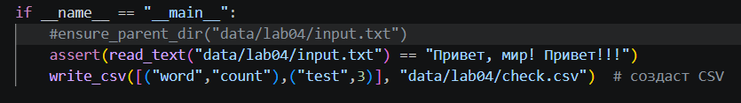
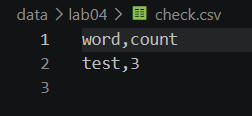
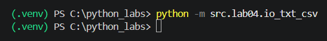
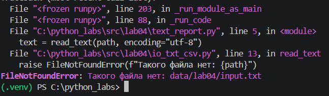
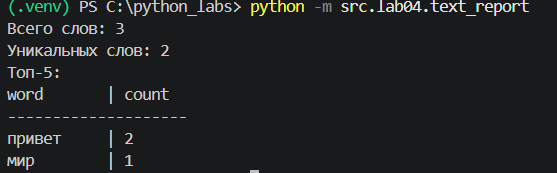
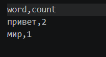
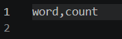
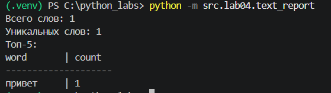
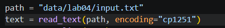

## ЛР4 — Файлы: TXT/CSV и отчёты по текстовой статистике

### Задание А

#### Файл считаем небольшим, поэтому считываем его полностью

### Задание B

#### Файла нет

#### Текст в файле "Привет, мир! Привет!!!"

#### Пустой файл

#### Открыть файл с кодировкой cp1251

