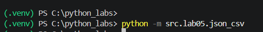
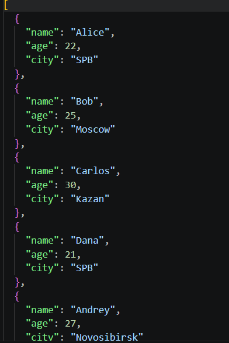
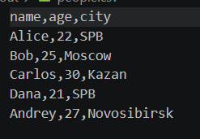
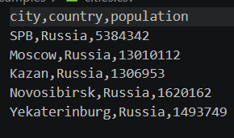
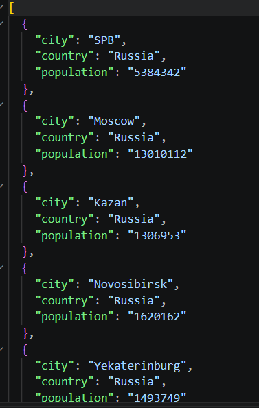
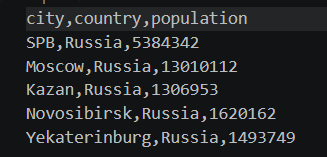
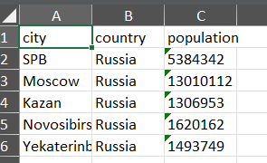

## ЛР5 — JSON и конвертации (JSON↔CSV, CSV→XLSX)

### Задание A — JSON ↔ CSV

#### Запуск модуля из терминала

#### Входные данные (файл json)

 

#### Выходные данные в формате csv, после применения функции json_to_csv

#### Входные данные (формат csv)

#### После применения функции csv_to_json

### Задание B — CSV → XLSX

#### Входные данные в формате CSV

#### Выходные данные в формате xlsx после выполнения функции

