## ЛР6 — CLI‑утилиты с argparse (cat/grep‑lite + конвертеры)

### Задание A — Реализация команд cat/stats

#### --help модуля

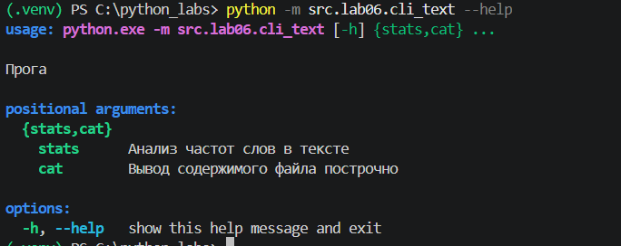

#### --help команды stats

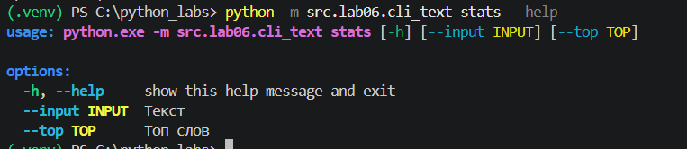 

#### Реализация команды stats

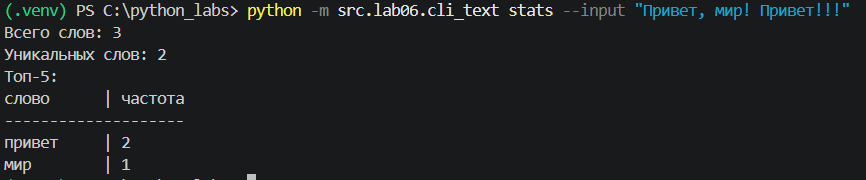

#### Реализация команды stats с опцией --top

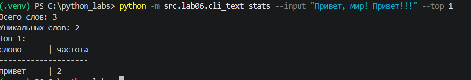

#### --help команды cat

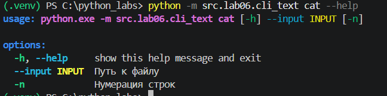

#### Реализация команды cat

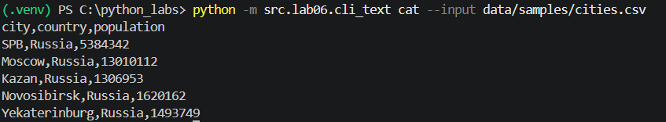

#### Реализация команды cat с опцией -n

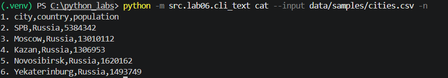

### Реализация команд json2csv/csv2json/csv2xlsx

#### --help модуля конвертации

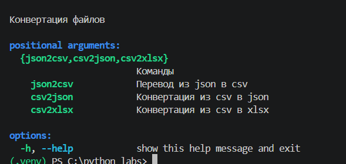

### --help команды csv2json

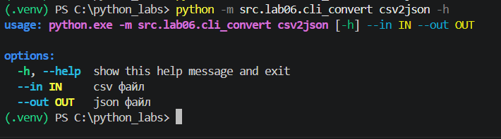

### --help команды json2csv

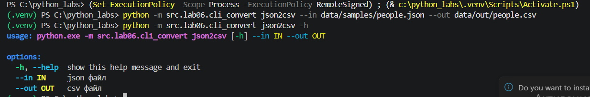

### --help команды csv2xlsx

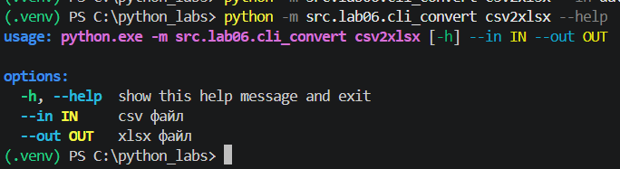

### Пример результата работы csv2xlsx

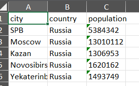
