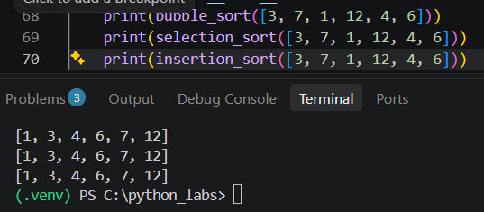
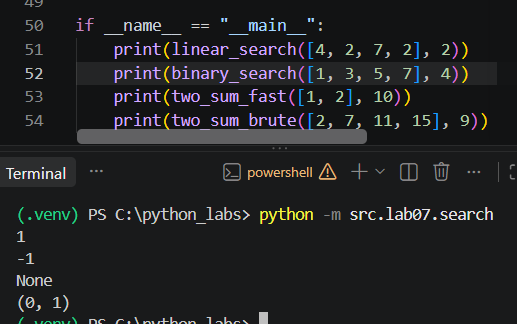
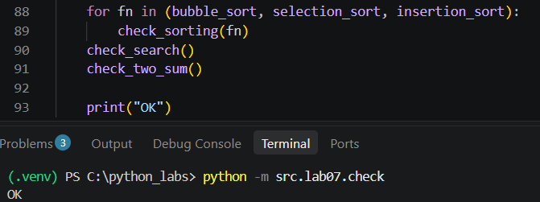
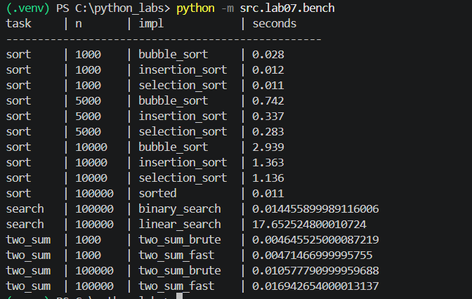
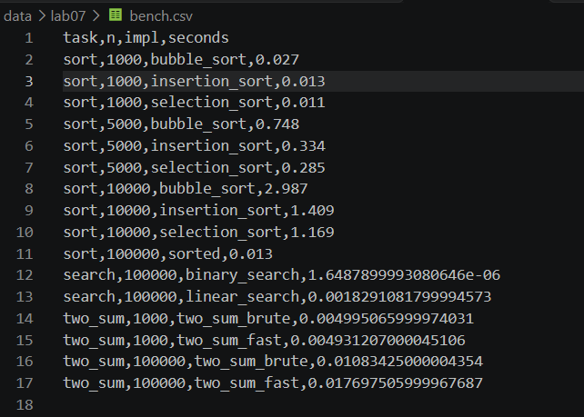

## ЛР7 — Поиск, сортировка и измерение времени

### Задание A — Поиск (search.py)

### Задание B - Сортировки (sorting.py)

### Задание С - Проверка против эталона (check.py)

### Задание D - Бенчмарк (bench.py)

### Вывод

Сложность алгоритма пузырек составляет O(n^2), а алгоритма sorted O(n*logn). Время сортировки пузырьком растет квадратично, время sorted растет медленнее
Бинарный поиск бесполезен на неотсортированном массиве, так как алгоритм на произвольном списке выдает неверный результат.
При больших n необходимость предварительно сотировать список окупается.
Модуль check показал ОК