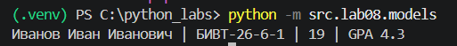
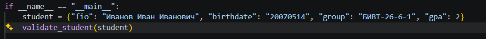
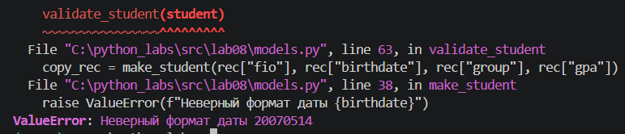
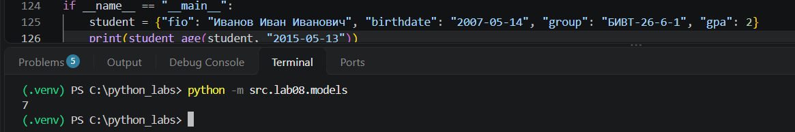
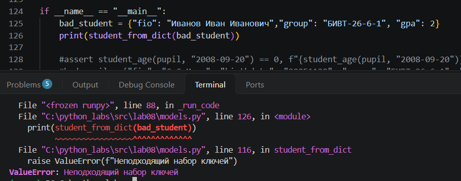
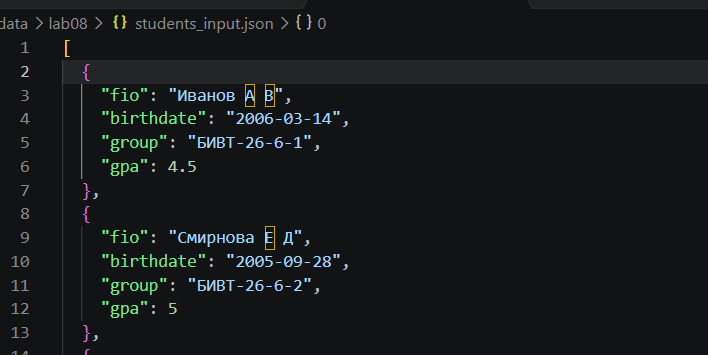
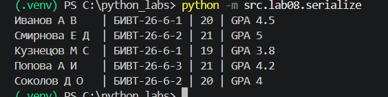

## ЛР7 — ЛР8 – Модель данных без классов: запись Student как словарь, валидация и сериализация

### Реализовать модель Student (models.py)

#### Функция make_student реализует создание объекта студент с валидацией передаваемых данных. Функция format_student отвечает за форматирование объекта студент в виде строки

#### Функция validate_student проверяет готовый словарь-студента

#### Функция student_age возвращает возраст студента относительно переданной даты

#### Функция student_to_dict копирует объект student, функция dict_to_student делает из словаря объект student

### Реализовать модуль serialize.py

